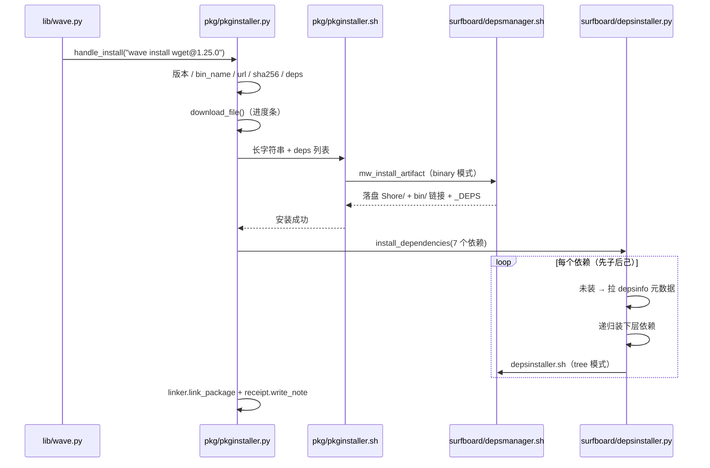

# 🌊 Summerwave 项目结构

> ✅ **已按 0.1.0（Summerwave 合并线）复核**：安装位置写死、没有配置文件、没有
> `--dir-option`；状态只有 `<base>/var/config.sh`；运行时布局是 `Shore/<名>/<版本>/`
> 加 `bin/` 无版本软链；索引不再分架构，瓶子标签写进记录名；客户端只下载 + 解包，
> 重定位在打包时做；渠道只有 `stable` / `preview`，客户端版本号是发布时刻。
> 历史叙述（4.x 的做法）保留在 `docs/RELEASE-*.md` 与 `docs/BRANCH-HISTORY.md` 里。

面向 macOS / Linux 软件开发者的包管理器，主要托管 iOS/iPadOS 相关软件包。
技术栈：Python + Shell。

- `main` 与版本分支（当前的 `4.1`）：程序代码，两者保持同步
- `MacWaveOrg/configdata` 仓库的 `main` 分支：**发布线的单一事实来源**（`versiondata/latest_version`：`version` / `release_date` / `branch`）。镜像同步据此决定同步哪些 `core/<分支>/`，工具与人据此知道当前发布线；**客户端不再读它** —— 4.4 起客户端读的是 `MacWaveOrg/Selfupdate` 的探针（`macwavedata/latest.toml`；`preview` 渠道读 `prerelease/latest.toml`），那份文件才决定装哪个版本、从哪个分支取代码、以及要执行的 `update_commands.sh` 的哈希
- `SummerwaveOrg/SeaLane` 仓库的 `main` 分支：纯数据（包与依赖的元数据、下载地址、校验值），依赖数据在 `deps/` 目录下

---

## 〇、组织与仓库格局（2026-11-28）

三个 GitHub 组织，**只有一个还在开发**：

| 组织 | 仓库数 | 状态 | 说明 |
| --- | --- | --- | --- |
| **`SummerwaveOrg`** | 5 | **活跃** | `Summerwave`（本体）、`SeaLane`（索引）、`Bottle`（产物）、`Python`（自带解释器）、`Pages`（官网） |
| `MacWaveOrg` | 14 | 全部归档 | MacWave 4.x 及以前：本体、Ports、Bottle、Deps、Selfupdate、configdata、infosource、pkgtest、docs、Pages、Bottle-src、Python |
| `LinuxWaveOrg` | 10 | 全部归档 | LinuxWave 4.x 及以前：本体、Bottle、Deps、Selfupdate、configdata、infosource、pkgtest、Ports、Pages、legacy-LinuxWave |

**归档 = 只读，不是删除**：代码、Release、Issue 都还在，能 clone、能查历史，只是不能推送。
所以 `Ports`、`pkgtest` 这类没迁移过来的东西也安全，需要时照样读。

### 归档前必须做的事

**先把 README 写好，再归档。** 归档之后仓库只读，README 就改不了了 ——
要补只能「临时解归档 → 改 → 重新归档」，每个仓库三步。

两个旧组织的每个 README 开头都有这段（中英双语）：

- 迁移提示：已并入 Summerwave，官网 301 到 summerwave.org，开发转到 `SummerwaveOrg/Summerwave`
- 旧安装继续可用：`wave` / `wave install` / `wave selfupdate` 不受影响，Release 保持可下载
- 新安装、issue、PR 一律去新仓库；本仓库只读

`docs/` 里有可直接复用的脚本写法（解归档 → 前置提示 → 重新归档），见
`~/MD/Summerwave/Summerwave-仓库归档与三组织格局.md`。

### 域名

| 域名 | 指向 | 现状 |
| --- | --- | --- |
| `summerwave.org` | `SummerwaveOrg/Pages`（GitHub Pages） | HTTP 正常；**HTTPS 证书待签发**（`https_certificate: 无`） |
| `macwave.org` | 同上（显示 Summerwave 内容） | 200，未设跨域 301 |
| `linuxwave.org` | `LinuxWaveOrg/Pages`（已归档） | 200，仍是 LinuxWave 旧站，未设 301 |

GitHub Pages **不做真正的 301**（纯静态托管）。要让旧域名跳过去，只有三条路：
旧 Pages 仓库放一个跳转页（`<meta http-equiv="refresh">` + JS，对用户等效但不是 301）、
把 DNS 迁到 Cloudflare 用 Page Rules 做 301、或者自己起服务器做 301。

---

## 一、仓库目录

```
lib/          入口与帮助
net/          传输层（地址表、TLS 策略、三档超时）
pkg/          安装与查询核心
surfboard/    依赖处理
scripts/      回归测试脚本
.github/      CI
.templates/   目录与文件的模板样例（bin/、pkg/）
.Pseudocode/  早期伪代码，仅作参考
docs/STYLE.md 代码风格约定
README.md     用户文档
```

## 二、各文件作用

### config/ —— 所有配置放的位置

MacWave 的配置只有这一处：**用哪些环境变量、默认值是什么、配置写在哪、装没装**。
这一层不做运行逻辑（不发请求、不解析命令行、不动安装树），也**只允许标准库依赖** ——
`lib/selfupdate.py` 会在「什么都没装」的解释器下导入这条路径。

| 文件 | 作用 |
| --- | --- |
| `envvar.py` | **环境变量名单、默认值与说明的唯一来源**：`DOMAINS`（七个 `MACWAVE_*_DOMAIN`，各带默认值与一句话说明）、`PIP_INDEX` / `PIP_DEFAULT`、`TEST_ROOT` / `TEST_ROOT_EXPORT`，以及 `name()` / `default()` / `description()` / `raw()`。只有数据：协议校验与拼 URL 在 `net/domains.py`。两份 shell 脚本里的同名默认值（它们是 `curl \| bash`，没法 source）由 `scripts/check_domain_defaults.py` 与本表逐项比对 |
| `configpaths.py` | **安装根与运行时布局的唯一来源**：`load_base_dir()` 直接返回 `rooted(DEFAULT_BASE_DIR)`（0.1.0 起安装根写死，没有配置文件、没有候选目录），另有 `payload_root()` / `bin_dir()` / `pkg_dir()` / `dep_dir()` 拼运行时路径。测试根（`MACWAVE_TEST`）是唯一旁路 |
| `configerror.py` | 启动前的环境自检：安装根里有 `var/config.sh` 就放行；没有且在 git 仓库里时，报错并提示用 `lib/install.sh` 正式安装 |

### lib/ —— 入口与帮助

| 文件 | 作用 |
| --- | --- |
| `wave.py` | 主入口。取写死的安装根（`configpaths.load_base_dir()`），把 `lib/`、`net/`、`pkg/`、`surfboard/` 注入 `sys.path`；用 `COMMANDS` 字典把 `install / uninstall / list / search / info / version / selfupdate / link / unlink / linkquery` 分发到对应模块，`ARGUMENTS` 处理 `-h/--help/-V/--version`；命令分发**之前**先拦下 `wave <命令> -h|--help`，交给 `help.print_command_help` 打印该命令自己的用法（否则各 handler 的白名单不认 `--help`：`install` 报错、`list` 静默忽略、`selfupdate` 会真的开始自更新） |
| `help.py` | 帮助与版本文本：`print_custom_help`（`-h` / `--help` 的用法，命令与旗标列表与 README 的 Command Reference 对齐）、`print_version`、`print_error_help`（未知命令时先报错再打帮助）；另有 `COMMAND_HELP` 表与 `print_command_help`（`wave <命令> --help` 的子命令用法，旗标只列该 handler 白名单里真正接受的，不承诺做不到的事） |
| `install.sh` | 官方安装脚本：安装根写死 `/opt/macwave`、`sudo` 提权、建运行时目录（`Shore` / `bin` / `pkg` / `surfboard` / `lib` / `net` / `cli` / `config` / `man` / `info` / `Keys` / `var` / `downloads/tmp`，还有 `python` 与 `venv`）、写状态文件 `<base>/var/config.sh`、**取 `macwavedata/<版本>/update_commands.sh` 并执行它来拉取全部程序文件**（4.4 起不再有 `files_info`：清单是生成出来的脚本，自己知道该下哪些文件、放哪里、怎么迁移）、**自带便携 Python**（3.1 起：读 `configdata/pythondata/latest_python` 下载并校验 sha256，解到 `python/<版本>/`，`current` 指向它），用它建 `venv/` 并在其中安装依赖（requests / packaging / rich）；下载失败则回退系统 `python3` 并提示、把 `bin/` + `lib/` 写入 PATH（升级时替换旧版只含 `bin`/`lib` 的行）、清理旧版平铺 `bin/` 文件、检查 Xcode 命令行工具（`otool` / `install_name_tool` / `codesign`）、`set -eE` 加 ERR 陷阱（中途失败时打印「安装未完成」、已下载内容可能残留的路径与重跑指引，**刻意不自动删除**）、用户协议**在动手之前问一次**（安装位置已写死，不再需要选择）（直接回车视为同意；4.7 起不再写 `AGREEMENT.json`，也没有「同意后再回滚」这条路径 —— 答 n 时磁盘上还什么都没改）：**非 macOS 一律不装**：`mw_platform` 先看
`uname -s`，只有 `macos` / `linux` / `unknown` 三种，非 macOS 一律拒绝并指路（Linux 去
LinuxWave，认不出的报出 `uname -s` 原值），都以退出码 2 收场。**iOS / iPadOS / Android /
ChromeOS 一概不单独识别 —— 这些设备上装不装得成，由用户自己保证**（判据要一种种单独维护，
猜错却全落在用户身上）。认成 macOS 之后再看版本：`sw_vers -productVersion` 低于 **10.15 Catalina**
直接拒绝并说明下限（再往下连捆绑的便携 Python 都起不来），读不到版本号时不判。
`MACWAVE_TEST` 下不判平台 —— 沙箱里宿主是 Linux 是常态。安装位置**只有一个**（写死的 `/opt/macwave`，无菜单、无 `--dir-option`、无自定义目录），协议与位置合成一次确认。`MACWAVE_VERSION` 与代码来源分支都从 Selfupdate 的探针（`macwavedata/latest.toml` 的 `version` / `branch`；`preview` 渠道是 `prerelease/latest.toml`，由 `MACWAVE_CHANNEL=preview` 选择）读取，不写死在脚本里，保证「下载的代码」与「写进 `var/config.sh` 的版本号」对应同一版本 |
| `uninstall.sh` | 卸载 MacWave 本体：安装根写死（`configpaths.load_base_dir()`，树不存在就退 0 当「没装」）、确认后删除安装目录、清掉 rc 文件里的 PATH 行、最后自删。确认从 **`/dev/tty`** 读，读不到就**中止并退 1**（删除不可逆，stdin 是 EOF 时不能当同意；无人值守请显式 `--force`）。自删有守卫：只有 `$0` 是**含本脚本标记的普通文件**时才删 —— 文档推荐的 `/bin/bash -c "$(curl ...)"` 下 `$0` 是解释器路径或 `--`，旧写法会把 `/bin/bash` 删掉。支持批量/脚本化卸载：`--force` 跳过确认、`--remove-user`（仅为与 LinuxWave 的参数兼容 —— MacWave 没有专用账号，实际不做任何事）、`-h/--help`。退出码有语义：`0` 完成（含「本来就没装」）、`1` 用法错误或无终端可确认、`2` 权限不足（sudo 跑不起来）、`3` 部分失败 —— 删除是「尽量多删、最后汇总」，单个目标删不掉不会中断后面的配置目录与 rc 清理，没删掉的清单写到 stderr |
| `selfupdate.py` | `wave selfupdate`：渠道从 `var/config.sh` 的 `MACWAVE_CHANNEL` 读（只有 `stable` / `preview` 两支，`stable` 读 `macwavedata/latest.toml`、`preview` 读 `prerelease/latest.toml`），把探针里的 `version` 与本机版本按**发布时刻**比较（`lib/versioncompare.py` 的 `client_key()`：`2026.11.26-15:52:43` → `99!20261126.155243`，所以任何时间戳都大于任何 4.x 的 PEP 440 版本）——已是最新则直接返回（`--dry-run` 在**问协议之前**就打印「会从哪个版本更新到哪个版本、分支、渠道、协议会不会问、超时」然后退 0，不下载、不跑脚本）；`preview` 没有更新的版本而 `stable` 有时，置 `MACWAVE_FULL_INSTALL=1` **全量**换到另一支（增量会把两条线混进一棵树）。确定要更新后，先看探针的 `selfupdate = "blocked"` 标记（必带 `selfupdate_reason`），命中就解释原因并**退 0**、一个字节都不改；然后才把随安装树发布的 `lib/selfupdate.sh` 复制到临时文件执行（不能在原文件上跑：它会被本次更新覆盖），通过环境变量 `MACWAVE_UPDATE_VERSION` / `MACWAVE_UPDATE_BRANCH` / `MACWAVE_UPDATE_CHANNEL` 把目标传下去；执行完**回读 `var/config.sh` 复核**
| `selfupdate.sh` | 自更新脚本，由 `selfupdate.py` 拉起（也可 `bash lib/selfupdate.sh [分支]`）：直接用写死的 `BASE_DIR` → 取一次渠道对应的探针（验 `latest.toml.sig`、读出 `update_commands_sha256`）→ 取 `macwavedata/<版本>/update_commands.sh` 并**先比对哈希再 `bash -n`** → 执行它（那份脚本自己按 `want <路径> <0|1> <sha256>` 逐文件下载、建目录、复位可执行位、跑目录迁移）→ 清掉 `__pycache__` → `prune_tree` 删掉清单之外残留的运行时文件 → 重写 `var/config.sh`（含 `MACWAVE_CHANNEL`）。4.4 起哈希不符**只警告**，`MACWAVE_STRICT_HASHES=1` 才失败。**以后新增文件只改生成器与清单，不用再动本脚本**

### net/ —— 传输层

「怎么连、连多久、连到哪」。**唯一允许发请求的层**：`pkg/` 与 `surfboard/` 里的请求
都只调用这里的策略。

| 文件 | 作用 |
| --- | --- |
| `domains.py` | 所有对外地址的唯一来源（七个 `MACWAVE_*_DOMAIN` 环境变量、默认值、校验与归一化） |
| `tls.py` | `--skip-ssl` 的唯一实现：`request_kwargs()` / `urlopen_kwargs()` / `curl_flags()`，分「请求」与「授权」两段 |
| `timeouts.py` | 三档超时（连接 / 读数据 / 总时长）的解析与折算，唯一来源是 `FLAG_FIELDS` |

契约由 `scripts/net_policy_test.sh` 用 AST 检查：缺 `**tls.request_kwargs()` 之类就红。

### pkg/ —— 安装与查询核心

| 文件 | 作用 |
| --- | --- |
| `pkginstaller.py` | **软件包安装编排**。解析参数（包名取第一个非 flag 的 token，`--limit-rate` / `--proxy` 的值会被跳过）与架构 → 定版本（`@版本`、`--ver` 或远程取最高）→ 拉 `_包名@common` 取 `bin_name` → 拉版本文件取 `url` / `sha256` / `deps` → 下载（rich 进度条、断点续传、限速、代理、30 秒超时+重试询问）→ 调 `pkginstaller.sh` → 通过 `depsinstaller` 递归安装依赖 → 最后调 `linker.link_package()` 把不带版本号的软链接指到刚装好的版本（`--no-link` 可跳过） |
| `pkginstaller.sh` | **软件包安装入口（binary 模式）**：组装长字符串，调用通用安装核心 `depsmanager.sh` 的 `mw_install_artifact`，输出安装结果。（4.6 起不再写 `installed.json`，见下） |
| `pkginfohelper.py` | `list`（扫描 `Shore/<包名>/<版本>/`）、`search`（远程匹配包名）、`info`（本地已装版本 + 远程可装版本 + `@common` 描述） |
| `pkgunzip.sh` | 按扩展名解压：`zip` / `tar.gz` / `tar.bz2` / `tar.xz` / `tar` / `gz` / `bz2` / `xz` / `conda`。裸 `xz` 用 Python 标准库 `lzma`（macOS 不自带 `xz` 命令）；**`.conda` 本质是个 zip，里装两个 zstd 压缩的 tar，只取 `pkg-*.tar.zst` 那个载荷**（`info-*.tar.zst` 是元数据），用 Python 3.14 的 `compression.zstd` 解（macOS 也不自带 `zstd`）—— **所以自带的 Python 必须是 3.14+**（3.1 起由 MacWave 自带，见 `pythondata`）；`extractall` 传 `filter='tar'`，因为 3.14 默认的 `data` 过滤器会拒掉 conda 包里的符号链接 |
| `uninstaller.py` | **卸载**：扫描 `Shore/<包名>/` 找出该包所有版本；删除包目录与软链接；按 `_DEPS` 删除依赖标记，若某依赖已无任何标记，则连同它自己的依赖一起级联删除（递归时带 `visited` 集合，避免循环依赖 A→B→A 造成无限递归）。卸载完调 `linker` 同步不带版本号的软链接：还有别的版本就改指最高的，一个不剩就删掉；本来就没链接过的不重建（悬空链接也在这里被治好）。加 `--no-link` 则不动这个链接 —— **但如果被删的版本正好是链接当前指向的那个，会报错并拒绝执行**（绝不留下指向已卸载版本的坏链接） |
| `linker.py` | **不带版本号的软链接**（仅限软件包，不碰依赖）：`link <名>[@latest]` / `link --all`（`-a`）建或改指链接，`unlink <名>` / `unlink --all` 删链接，`linkquery <名>` 看当前指向（输出形如 `🌊 ffmpeg@9.0`；未链接退 1，**指向已不存在的版本也报错退 1**）。`installed_versions` / `linked_version` / `is_dangling` 分别扫 `Shore/`、读 `bin/` 软链、判断是否悬空；重复 link 会报 `already linked` |

### surfboard/ —— 依赖处理（2.2 新增）

| 文件 | 作用 |
| --- | --- |
| `depsinstaller.py` | **依赖安装编排（Python）**。校验/解析依赖引用 → 拉 `_依赖名@common` 取 `dep_name` → 拉 `_依赖名@版本号` 取 `url` / `sha256` / `deps` → 复用 `pkginstaller.download_file` 下载（进度条与软件包一致）→ 调 `depsinstaller.sh` → 递归安装子依赖；依赖已安装时只补标记（走 `tagger.sh` 命令行） |
| `depsinstaller.sh` | **依赖安装入口（tree 模式）**：`source depsmanager.sh` → 调 `mw_install_artifact` → 在依赖目录里创建 `.depped_pkg_*` / `.depped_dep_*` 标记 |
| `depsmanager.sh` | **通用安装核心**（被 `pkginstaller.sh` 与 `depsinstaller.sh` source，不单独执行）：定位下载到的原文件、SHA256 校验、解压、落盘（`binary` / `tree` 两种形态，0.1.0 起两者都落在 `Shore/<名>/<版本>/`）、创建 `bin/` 软链接、写 `Note` 收据、标记文件辅助函数。`mw_extract_binary` 与 `mw_extract_all` 里各有一串扩展名，**加新格式时两处都得补**，漏一个就会出现“把压缩包当二进制装下去”的静默错误 |
| `tagger.sh` | `.depped_*` 标记文件原语：`tagger_create` / `tagger_delete` / `tagger_has_any`，既可 `bash tagger.sh <动作> …` 调用，也可被 source |
| *（`transfer.sh` 已于 0.1.0 删除）* | 运行时不再改字节：重定位改在**打包时**做，见 `scripts/relocate_rpath.py`（判据与 4.6 的 `transfer.sh --check` 同一套）。客户端只剩「下载 + 解包」 |
| `querier.py` | 查询依赖是否已安装：`Shore/{引用名}/{版本号}/` 存在**且含 `Note` 收据**才算安装完成（避免中途失败留下的空目录被误判）；依赖引用解析（强制 `依赖名@版本号`，名字与版本都过路径白名单，如 `parse_dep_ref`）也在这里 |

### scripts/ 与 CI

| 文件 | 作用 |
| --- | --- |
| `scripts/format_test.sh` | 10 种打包格式（无扩展名 / zip / tar.gz / tar.bz2 / tar.xz / tar / gz / bz2 / xz / **conda**）逐个跑 install → 运行 → uninstall；跑完再断言装完自动建了不带版本号的链接，以及 `install --no-link` 不建链接 |
| `scripts/audit_deps.py` | **依赖审计**。`data` 模式：查 infosource 数据的 `deps` 引用格式（必须一行一个引用）、`url` / `sha256` / `bin_name` 完整性，以及被引用的 `@common` 与版本文件是否存在（本地有数据就读本地，否则从 GitHub 拉取）；`edges` 模式：把已安装依赖的实测 Mach-O 引用与数据声明对比，找出漏声明的依赖边。`--ignore 正则` 可跳过已知历史问题；加 `--check-urls` 会额外联网逐个确认 url 可达（默认关闭，因为依赖网络；数据里的 `test_*` 测试包故意用假 url，开它时要配 `--ignore 'test_'`）；发现真问题时退出码 1 |
| `scripts/deps_test.sh` | **依赖链端到端回归**：装一个带依赖链的包（默认 `wget@1.25.0`）→ 跑 `--version` 验证 relink → 检查安装日志里没有未解析的库引用 → 检查 `.depped_*` 标记已写入 → 卸载并确认依赖目录与软链接被级联清理 |
| `scripts/selfupdate_test.sh` | **自更新回归**（必须放最后，它会真的改安装目录）：① 离线单测 `selfupdate.py` 的 `parse_version_data`（含 `<<<`/`>>>` 多行命令）与 `version_key`；② 把 `var/config.sh` 写成 `9999.0`，断言 `wave selfupdate` 短路为「已是最新」且退出码 0；③ 写成 `0.1`，跑真实自更新，最后断言 `var/config.sh` 等于探针（`macwavedata/latest.toml`）声明的版本 |
| `scripts/link_test.sh` | **不带版本号软链接回归**：装完自动建链接 → 不带版本号能跑 → `link` / `unlink` / `linkquery` → `-a` 批量 → 卸掉最高版自动降级（先复制一份目录造出 2.0，不依赖 infosource 真有该版本）→ `uninstall --no-link` 不降级 → `install --no-link` 不建链接 → 卸掉最后一个版本时删掉链接 |
| `scripts/configpath_test.sh` | **安装根与布局回归**（离线）：安装根写死、`Shore/` + `bin/` 布局常量、状态只从 `<base>/var/config.sh` 读、软链接越界守卫 |
| `scripts/sandbox_test.sh` | **安装器 / 卸载器隔离回归**（仅 macOS）：用 `sandbox-exec` 起一个「默认拒绝、只允许写沙箱目录 + `/dev` + 临时目录」的沙箱，配合 `file://` 离线镜像与替身 `sudo`，**不需要网络、也写不到 `/opt`、`/usr/local`、`/etc` 与真实家目录**。64 条断言覆盖：用户级安装目录端到端、系统级目录的落位（越过沙箱边界即失败，并打印选中的安装/配置目录）、参数校验、协议顺序与拒绝后的回滚、中途失败的指引且不误删、卸载确认语义（无终端 / n / y / `--force`）、卸载器自删（`$0` 是文件 vs 解释器，且 `/bin/bash` 必须存活）、复用 `link_test.sh`。沙箱自检那组用来证明隔离真的生效 |
| `.github/workflows/format-test.yml` | 在 `macos-latest` 上按 `scripts/components.txt` 把各组件目录部署到 `/tmp/macwave-test`，依次跑配置目录回归、依赖审计、格式回归、依赖链回归、链接回归、**selfupdate 回归** |

## 三、安装后的运行时目录

`BASE_DIR` 是**写死**的，来自 `config/platforminfo.py` 的 `DEFAULT_BASE_DIR`：
macOS 是 `/opt/macwave`，Linux 是 `/home/linuxwave/.linuxwave`。
没有菜单、没有候选目录、没有 `--dir-option`，也没有配置文件可读 —— 一台机器一棵树。

状态只有一份，就在树里：`<base>/var/config.sh`（`MACWAVE_VERSION` / `MACWAVE_BUILD` /
`MACWAVE_INSTALLED_AT`）。它由 `install.sh` 与 `selfupdate.sh` 在**所有文件到位之后**写，
是「装好了」的唯一凭据。

**要不要提权**：`install.sh` 用「写权限」判断 —— 目标树 `-w` 就不提权。
判断分两步：先 `test -w`，再往目标目录（或最近的已存在祖先）里建一个**空文件探针**
并立刻删掉。探针只有两种失败要区分开：`Permission denied` 才当作「需要提权」，
其它（磁盘满、路径不存在）直接报错退出。`--skip-probe` 只跳过探针、保留权限位判断；
`--dry-run` 承诺不写文件，因此只用静态判断。

不需要 SIP / SSV 判定：`/opt` 从来不在 SIP 保护范围内。
（4.x 那套判断存在的前提是「可能装到 `/usr`、`/System`」，这个前提已经消失。）

```
BASE_DIR/Shore/<名>/<版本>/                   解开的软件包与依赖（同构）
BASE_DIR/Shore/<名>/<版本>/Note               收据（JSON；requested 区分包/依赖）
BASE_DIR/bin/<命令>[@<版本>] -> ../Shore/<名>/<版本>/…   PATH 里唯一要加的目录，只放链接
BASE_DIR/downloads/tmp/                       下载临时目录（*.partial 表示未下载完）
BASE_DIR/{lib,pkg,surfboard,cli,config,net}/  程序文件自身
BASE_DIR/{man,info,Keys}/                     手册、info、验签公钥
BASE_DIR/var/config.sh                        已安装的版本与渠道（唯一的状态）
```

4.x 的 `bin/<名>@<版本>/`、`deps/…`、`links/` 已经不存在；0.1.0 的 `apply_migrations`
只做一件事：把这些旧目录搬进 `Shore/`。

## 四、数据源（`SummerwaveOrg/SeaLane` 仓库）

软件包：

```
pkg/pkginfo/{包名}/_{包名}@common                     bin_name / des / hom / lic / aut
pkg/pkginfo/{包名}/_{包名}@{版本号}.{os}-{arch}        url / sha256 / deps
```

依赖：

```
deps/depsinfo/{依赖名}/_{依赖名}@common                 dep_name / des / hom / lic / aut
deps/depsinfo/{依赖名}/_{依赖名}@{版本号}.{os}-{arch}     url / sha256 / deps
```

- 索引**不再按架构分目录**：单远端，架构写在记录名与产物文件名的瓶子标签里
- 标签词表封闭：`{os}` 为 `macos` / `linux`，`{arch}` 为 `arm64` / `amd64`（`x86_64` 归一成 `amd64`），
  由 `config/platforminfo.bottle_tag()` 生成，见 `docs/DATA-LAYER.md` 末节
- 下载地址强制 `https://`
- **`deps` 写在版本文件里**（不是 `@common`），每行一个 `依赖名@版本号`，多行书写：

```
deps: "gettext@0.21.0"
      "openssl@3.0.15"
      "zlib@1.2.13"
```

- 简易 DSL 解析规则：行内第一个引号**前**有 `字段:` 声明，该行属于该字段；否则向上回溯到最近的字段声明；同一字段多行合并为列表。`deps` 字段缺失即视为无依赖
- 依赖引用格式强制 `依赖名@版本号`，不合规直接报错退出
- 依赖名/版本在 `deps/depsinfo/` 里找不到时报错退出

## 五、目录迁移与自更新边界

0.1.0 起**没有任何配置目录**，状态只有 `<base>/var/config.sh` 一份，于是 4.x 那套
「`updatedata/{版本}/dir_structure_change` + `transfer_commands`」的数据驱动迁移
连同 `MACWAVE_INSTALL_DIR` 注入一起删掉了 —— 结构再变也只有一个方向：往新布局搬。

留下来的是 `install.sh` 里的 `apply_migrations`，只做**目录搬家**（幂等、可重复跑）：

```
bin/<名>@<版本>/   → Shore/<名>/<版本>/
deps/<名>/<名>@<版本>/ → Shore/<名>/<版本>/
links/*           → bin/（无版本号的软链接）
```

- 只在目录结构确实变过时才生效；搬完立刻删掉旧目录，不保留兼容读取路径
- 运行时文件的多余残留交给 `sync_tree` 之后的 `prune_tree`：只删 `MANAGED_ROOTS`
  （`cli config lib net pkg surfboard man info Keys`）里清单之外的文件，绝不碰
  `Shore/`、`var/`、`venv/`、`python/`、`downloads/`。这是跨版本升级能自愈的关键
- **不存在「跨大版本禁止 selfupdate」**：客户端版本号就是发布时刻（`2026.11.26-15:52:43`），
  按「大版本号」比较在 1 月 1 日会把每一次升级都判成跨大版本。该拦的时候由发布方在
  探针里写 `selfupdate = "blocked"`（必带 `selfupdate_reason`），两处执行点都会礼貌拒绝并退 0

## 六、关键机制

1. **目录 + 软链接**：包与依赖都不再以“单个文件”形式存在，而是目录；`bin/` 里放软链接并已加入 PATH。`名字@版本号` 永远可用；想让 `名字` 也能直接跑，用 `wave link <名>` 建一条不带版本号的软链接（自动跟随最高已装版本），或装的时候默认就会建（`--no-link` 可关掉）
2. **两种安装形态**（共用 `depsmanager.sh` 的同一套流程）：
   - `binary`（软件包）：解压后只取一个可执行文件，同名优先，找不到同名则取第一个并打 YELLOW 警告
   - `tree`（依赖）：保留整棵解压目录（库包不能只取一个文件）；包内 `bin/` 下的每个文件都软链到 `<根>/bin/{名字}@{版本号}`，因此不依赖“与包同名的可执行文件”
3. **`_DEPS`**：安装后写入，每行形如 `"a@1.0"`；卸载时据此清理依赖
4. **`.depped_*` 标记**：记录“谁依赖了我”
   - `.depped_pkg_{包名}@{版本号}`：被某个软件包依赖
   - `.depped_dep_{依赖名}@{版本号}`：被某个依赖依赖
   - 卸载时先删掉自己的标记；某依赖已无任何标记，才连同它自己的依赖一起级联删除，多个依赖者共享时不会被误删
5. **递归**：依赖自身的 `deps` 会被继续安装（先装下层、再装自己）
6. **动态库路径（构建端完成）**：依赖包里的库不会自动被 dyld 找到（conda 包的 install name 是 `@rpath/xxx.dylib`，自带 rpath 只有 `@loader_path/`，跨目录必然失败）。0.1.0 起这道改写由 `scripts/relocate_rpath.py` 在**打包时**统一做完（先处理依赖再处理软件包，因为声明顺序与实际库依赖顺序未必一致——例如 `wget` 的 `deps` 里 `libidn2` 排在 `libunistring` 前面，而 `libidn2.0.dylib` 恰好引用 `libunistring.5.dylib`），客户端装完不再扫产物。判据与 4.6 的 `transfer.sh --check` 相同：`@rpath/<名>` 不能无条件算数
7. **收据**：`Shore/<名>/<版本>/Note` 是「这个东西装好了」的唯一凭据，`requested` 区分软件包与依赖
8. **网络**：所有请求 30 秒超时；下载超时或连接失败时询问是否重试

## 七、代码约定

见 `docs/STYLE.md`，要点：

- Python 文件头 5 行：shebang / 空行 / `# 文件名` / 空行 / 代码，其后用 `# -------------------- 分区名 --------------------` 分区
- 颜色常量模块级单引号：`RED_BOLD` / `GREEN` / `YELLOW` / `RESET`
- 所有输出带 🌊 前缀；错误 `print(f"{RED_BOLD}🌊 Error: …{RESET}")` 后 `sys.exit(1)`
- Shell 脚本 `set -e`，同样的颜色定义与 🌊 前缀
- 脚本之间用 `\n` 分隔的长字符串传参；安装信息为 8 行：名称 / 版本号 / sha256 / 目标目录 / BASE_DIR / 可执行文件名 / 依赖者 / 原文件名

### 共享代码块：三份副本 + 一个正本

有三个脚本是**被 curl 下来直接执行**的独立文件，没法 `source` 仓库里的东西：

| 脚本 | 什么时候跑 |
| --- | --- |
| `lib/install.sh` | 全新安装 |
| `lib/selfupdate.sh` | 4.7 → 4.8 及以后的升级（跑的是**已装那一版**） |
| `scripts/update_commands.template.sh` → 生成的 `macwavedata/<版本>/update_commands.sh` | 4.6 → 4.7 的升级（旧客户端执行**新代码**，是那一路唯一能跑到的新逻辑） |

同一段逻辑要在三处都成立（例如 4.7 的「清理旧版外部配置目录」），就只能各带一份副本。
副本一定会漂移，而漂移的后果不是崩溃，是「某一条路径上少了半句判断」——

- **正本**：`scripts/shared/<名字>.sh`，正文用 `# >>> SHARED: <名字>` / `# <<< SHARED` 包起来
- **副本**：原样拷进每个需要的脚本，标记也要一起拷
- **共享块（已随 0.1.0 删除）**：以前 `lib/install.sh` 与 `lib/selfupdate.sh` 各抄一份
  验签代码，由 `scripts/check_shared_blocks.py` 逐字节盯着。`selfupdate.sh` 在 0.1.0
  被 `lib/selfupdate.py` 取代（验签挪到 Python 的 `_verify`），只剩一份副本，闸门与
  它的测试一并删掉。现在唯一的「共享」是 `MW_RSA_PUB_PEM`，由
  `scripts/embed_rsa_pub.py` 按标记替换，Python 侧从 `lib/install.sh` 里抠它当锚点。
判据类的东西尤其要这样收：它藏在三条不同的代码路径里，只有其中一条出错时最难查。

---

## 八、安装「带依赖的软件包」时，各程序依次做什么

以 `wave install wget@1.25.0` 为例（`_wget@1.25.0` 的 deps 为
`gettext@0.21.0`、`libiconv@1.16`、`libidn2@2.3.8`、`libunistring@1.3`、`openssl@3.0.15`、`pcre2@10.42`、`zlib@1.2.13`，
其中 `gettext` 自己又依赖 `libiconv@1.16`）。

### 步骤总览

| # | 程序 | 做什么 |
| --- | --- | --- |
| 1 | `lib/wave.py` | 取写死的安装根并把 `cli/`、`config/`、`lib/`、`net/`、`pkg/`、`surfboard/` 注入 `sys.path`；按 `COMMANDS` 字典把 `install` 分发给 `pkginstaller.handle_install("wave install wget@1.25.0")` |
| 2 | `pkg/pkginstaller.py` | 解析下载参数（`-v` / `-C` / `--skip-ssl` / `--limit-rate` / `--proxy`，白名单校验）；解析包名与架构 |
| 3 | `pkg/pkginstaller.py` | 定版本：`@版本号` → `--ver` → 都没有则调 `fetch_max_version()`（GitHub API，`SummerwaveOrg/SeaLane` 仓库的 main，带 `?ref=main`） |
| 4 | `pkg/pkginstaller.py` | 拉 `_wget@common`，解析出 `bin_name`（缺失即报错） |
| 5 | `pkg/pkginstaller.py` | 拉 `_wget@1.25.0.macos-arm64`（记录名带瓶子标签），解析出 `url` / `sha256` / **`deps`**（多行，向上回溯的 DSL 解析）；校验 `url` 必须是 https |
| 6 | `pkg/pkginstaller.py` | `download_file()` 下载到 `downloads/tmp/`（rich 进度条、`.partial` + 断点续传、限速、代理、30 秒超时后询问重试），完成后去掉 `.partial` 后缀 |
| 7 | `pkg/pkginstaller.py` → `pkg/pkginstaller.sh` | 传长字符串（含目标目录 `Shore/wget/1.25.0`）与依赖列表，`pkginstaller.sh` 用 `binary` 模式安装 wget 本体 |
| 8 | `surfboard/depsmanager.sh` | `mw_install_artifact`：定位原文件 → SHA256 校验 → 解压 → 取一个可执行文件（同名优先，否则取第一个并打警告）→ `chmod 755` → 整目录落在 `Shore/wget/1.25.0/` → 建软链接 `bin/wget@1.25.0` → 写 `_DEPS` |
| 9 | `pkg/pkginstaller.sh` | 打印安装结果（4.6 起不再维护 `installed.json`） |
| 10 | `pkg/pkginstaller.py` | 调 `depsinstaller.install_dependencies()`，逐个安装 7 个依赖 |
| 11 | `surfboard/depsinstaller.py` | 每个依赖 `ensure_dependency()`：校验引用格式 → `querier.is_installed()` 判断是否已装（`Shore/<依赖>/<版本>/` 存在且带 `Note` 收据） |
| 12 | `surfboard/depsinstaller.py` | 未装时：拉 `_依赖名@common` 取 `dep_name`、拉 `_依赖名@<版本>.<标签>` 取 `url` / `sha256` / `deps`；找不到则报 `Dependency '…' not found in depsinfo.` 并退出 |
| 13 | `surfboard/depsinstaller.py` | **先递归装下层依赖**（`gettext` 会先把 `libiconv` 装好）→ 再下载自己（复用第 6 步的同一个 `download_file`，进度条一致）→ 调 `surfboard/depsinstaller.sh` |
| 14 | `surfboard/depsinstaller.sh` → `depsmanager.sh` | `tree` 模式安装：整棵解压目录落到 `Shore/{依赖名}/{版本}/`（与软件包同构），单顶层目录自动下沉一层，包内 `bin/` 下每个文件都 `chmod 755` 并各建一条软链接进 `bin/`，写 `Note` 收据 |
| 15 | `surfboard/depsinstaller.sh` | 按传入的依赖者信息创建标记：被包依赖 → `.depped_pkg_wget@1.25.0`，被依赖依赖 → `.depped_dep_gettext@0.21.0` |
| 16 | `surfboard/depsinstaller.py` | 已安装的依赖：跳过下载，只调 `tagger.sh` 补标记（例如 `libiconv` 同时被 `gettext` 和 `wget` 依赖，就会有两条标记） |
| 17 | `pkg/pkginstaller.py` → `pkg/linker.py` | 依赖全部就位后，把 `bin/wget` 指向 `Shore/wget/1.25.0/wget`（不带 `--no-link` 时）；第 8 步建好的 `bin/wget@1.25.0` 不受影响 |
| 18 | `pkg/receipt.py` | 最后写 `Shore/wget/1.25.0/Note`：收据里的 `requested` 区分「用户点名装的包」与「顺带装的依赖」，卸载与体检据此判断谁是主角 |

> **路径重定位不在这个流程里**：0.1.0 起客户端只做「下载 + 解包」，Mach-O 的 `@loader_path`
> 改写与 ad-hoc 重签名都在打包时由 `scripts/relocate_rpath.py` 完成，所以装完不用再扫一遍。

### 时序



### 为什么要这个顺序

- **依赖先于收据**：`Note` 里的 `requested` 要写清「这个包为什么在这儿」，而只有依赖装完才知道自己是不是被牵连进来的
- **`_DEPS` 先写**：它是卸载时清理依赖的唯一依据
- **标记文件在最后打**：只有依赖真正装好了才记录"谁依赖了我"，避免中途失败留下错误标记
- **不再需要统一改写路径**：4.x 因为「引用指向 `deps/…/lib` 里的真实文件、而声明顺序与实际库依赖顺序未必一致」才必须攒到最后一次性改写；这份工作现在在构建端完成，客户端没有这一步

### 这条命令跑完后的目录形态

```
BASE_DIR/Shore/wget/1.25.0/                    wget 二进制 + _DEPS + Note
BASE_DIR/Shore/gettext/0.21.0/                 bin/ lib/ include/ … + Note + .depped_pkg_wget@1.25.0
BASE_DIR/Shore/libiconv/1.16/                   … + Note + .depped_pkg_wget@1.25.0 + .depped_dep_gettext@0.21.0
BASE_DIR/Shore/{libidn2,libunistring,openssl,pcre2,zlib}/<版本>/   各自整树 + Note + .depped_pkg_wget@1.25.0
BASE_DIR/bin/                     wget（不带版本号）与 wget@1.25.0，
                                  以及每个依赖 bin/ 下可执行文件的一条带版本链接
                                  （如 openssl@3.0.15、iconv@1.16、msgfmt@0.21.0 …）—— 此目录已在 PATH 上
```

卸载时的逆向动作见「六、关键机制」第 3、4 条：先删自己的标记，某个依赖再无任何标记时才连同它的依赖一起级联删除。

---

## 九、新增版本分支（如 `4.2`）时要改的地方

`main` 与「发布分支」互为镜像，而**发布分支由数据决定**：`MacWaveOrg/configdata` 的 `versiondata/latest_version` 里的 `branch` 字段（现为 `4.1`）。`.github/workflows/sync-release-branch.yml` 会随之把两边保持同步（只做快进，分叉则报错交给人工），**这个工作流本身不用改**。

新开一个版本分支时只需要：

| # | 改哪里 | 改成什么 |
| --- | --- | --- |
| 1 | `MacWaveOrg/configdata` 的 `versiondata/latest_version` | `branch` 指向新分支（新分支成为发布线时），`version` / `release_date` 一并更新（0.1.0 起没有 `build_number`） |
| 2 | `.github/workflows/format-test.yml` | 把新分支名加进 `on.push.branches` 与 `on.pull_request.branches` |
| 3 | `docs/PROJECT_CONTEXT.md` 开头的「版本分支（当前的 `4.1`）」 | 改成新分支 |
| 4 | `README.md` / `README.zh-Hans.md` 的 `Latest Version` / `最新版本` | 正式发布时更新 |
| 5 | 站点 `index.html`（`MacWaveOrg/Pages`） | 版本行的版本号 |

镜像只认 configdata 声明的那一个发布分支，所以 `2.3` / `2.4` / `2.5` 这类历史分支不会被碰到。
